<p align="center">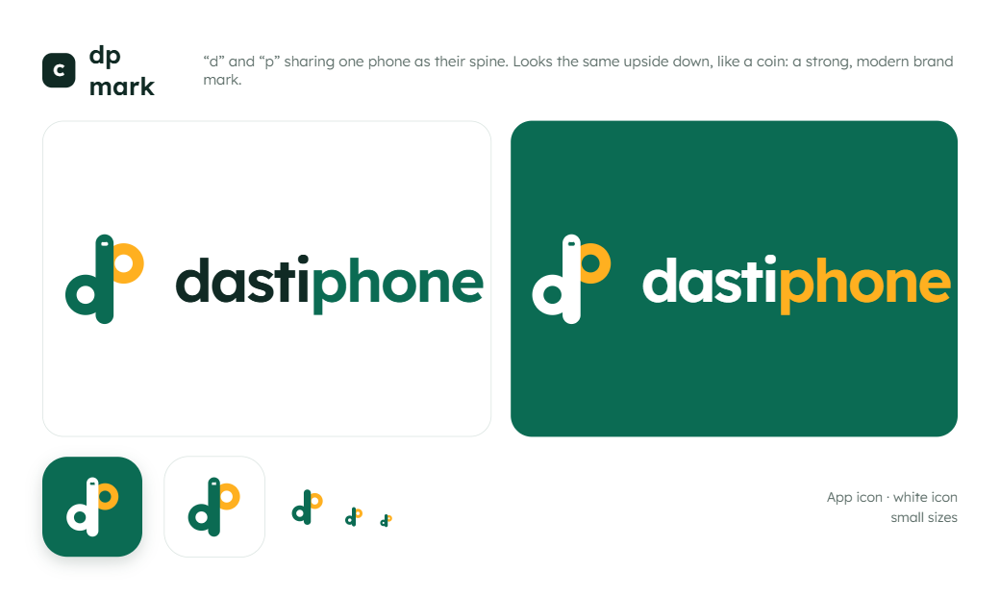</p>
<h1 align="center">Dastiphone</h1>
<p align="center"><b>A marketplace to buy and sell new and used phones in Pakistan, with a web app and an Android app</b></p>

<p align="center">
  
  
  
  
  
  
  
  
  
</p>

> 🔒 **Source code is private.** This repository is a public showcase of the product.
> Code walkthroughs are available for interviews: **umarnasrullah870@gmail.com**

---

## 💡 What it is

Dastiphone ("hand-to-hand phone") is an OLX-style marketplace built only for phones. Buyers can filter by
**PTA status, battery health, storage, RAM, condition and city**, and chat with sellers in real time.
Sellers post an ad in two minutes. The web app and the Android app share one API, one database and one account system.

## ✨ Features

- **Smart search & filters:** brand, model, price range, PTA approved / non-PTA, battery health, storage, condition and seller type
- **Phone ad pages:** photo gallery, full specifications, seller card, "buy safely" tips and similar phones
- **Post an ad:** guided form with auto-filled specs for the selected model, condition grading, photos and location
- **Real-time chat:** buyer-seller messaging with quick replies (Socket.io)
- **Accounts:** sign up with SMS code, Google or email; saved phones and saved searches with price-drop alerts
- **Seller profiles:** verified badges, active and sold ads, reply time
- **Admin panel:** review and approve ads, ban users (logs them out and hides all their ads)
- **Bilingual:** shared English / Urdu text, colours and fonts between web and app
- **Production-ready:** Cloudinary image uploads, password-reset email (Resend), Nginx + PM2 deployment scripts and database backups

## 🏗️ Architecture

```text
 Website (React + Vite + Tailwind) ─┐
                                    ├──► Node + Express + TypeScript API ──► MongoDB Atlas
 Android app (React Native + Expo) ─┘          │  Socket.io (chat)
                                               ├──► Cloudinary (photos)
                                               └──► Resend (emails)
 Hosting: VPS with Nginx reverse proxy + PM2, automated backups
```

## 🌐 Website

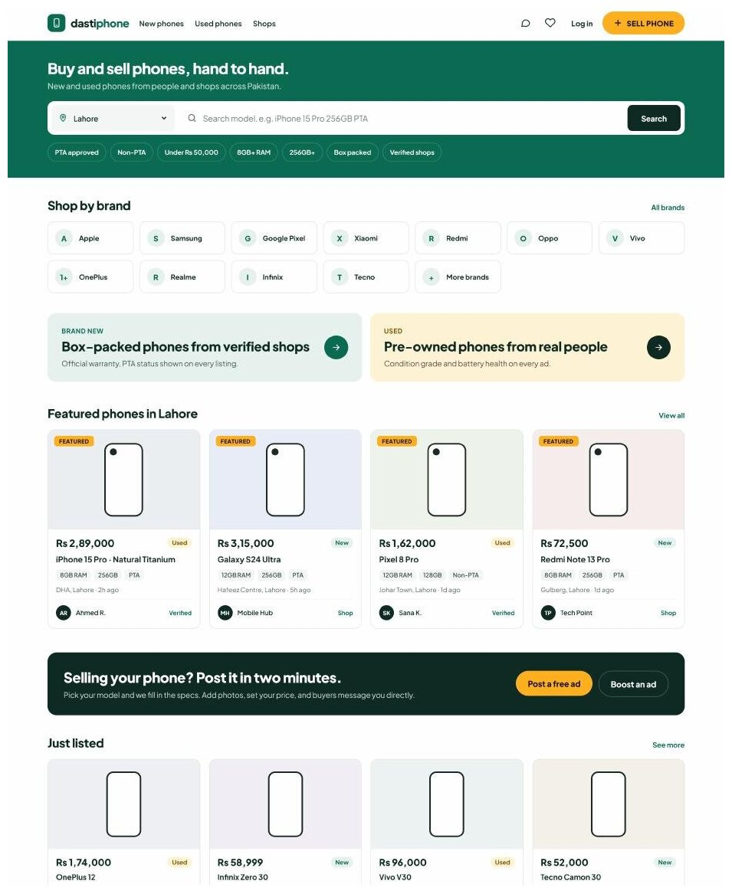

| Search & filters | Phone details |
|---|---|
| 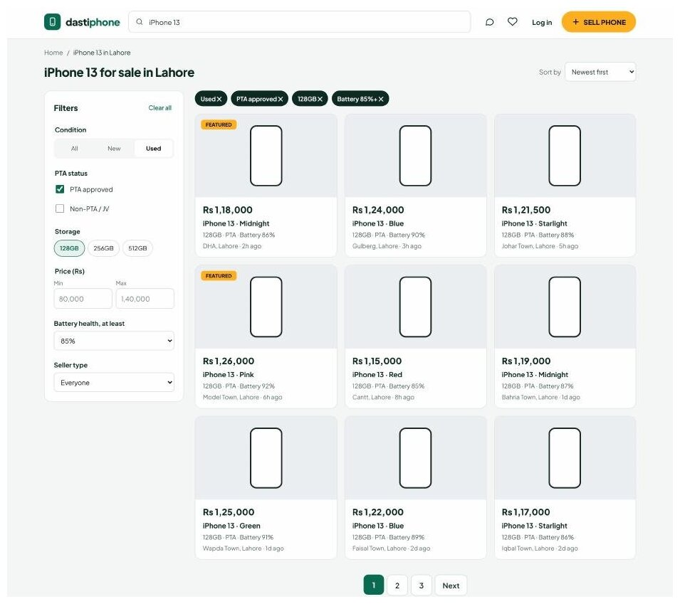 | 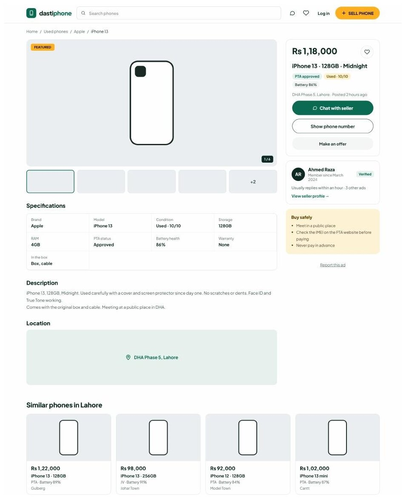 |
| **Post an ad** | **Messages** |
| 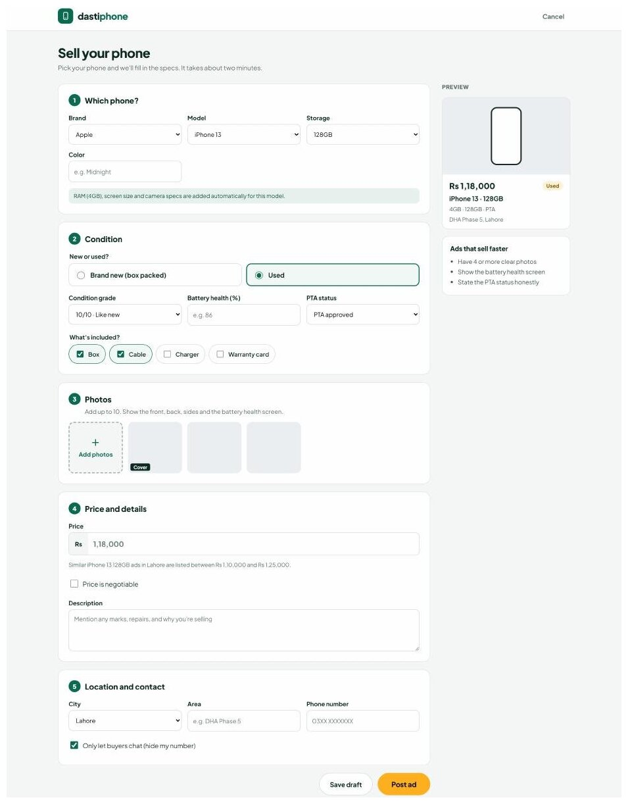 | 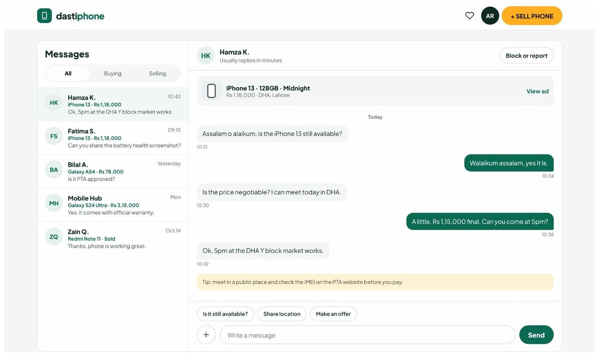 |
| **Seller profile** | |
| 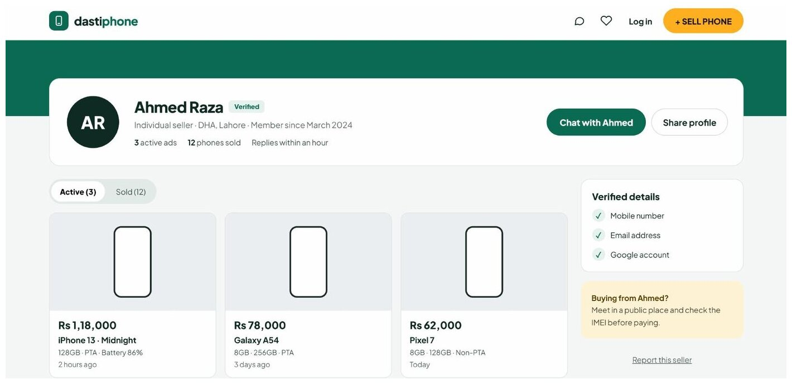 | |

## 📱 Android app (React Native + Expo)

<table>
  <tr>
    <th>Home</th><th>Search</th><th>Phone details</th><th>Sell your phone</th>
  </tr>
  <tr valign="top">
    <td>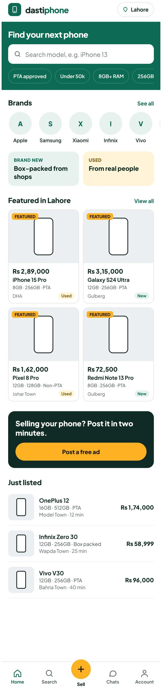</td>
    <td>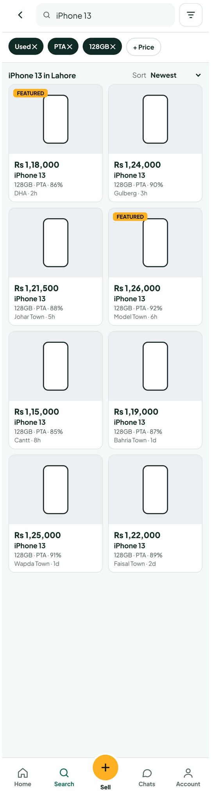</td>
    <td>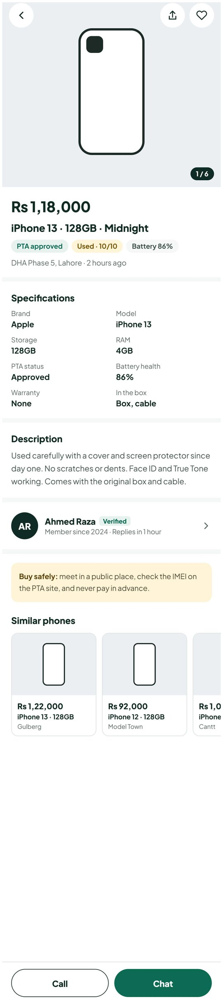</td>
    <td>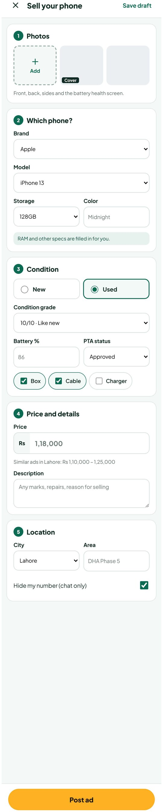</td>
  </tr>
  <tr>
    <th>Login</th><th>Create account</th><th>Chat</th><th>Saved phones</th>
  </tr>
  <tr valign="top">
    <td>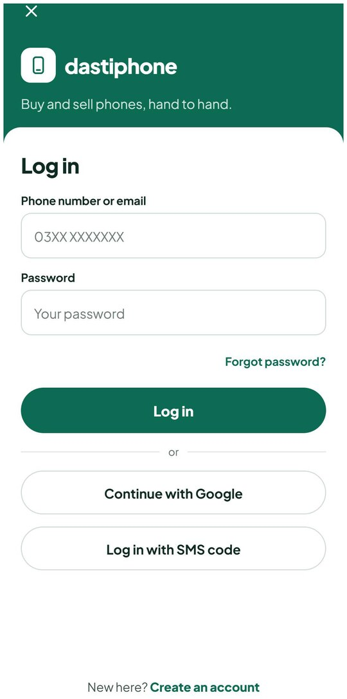</td>
    <td>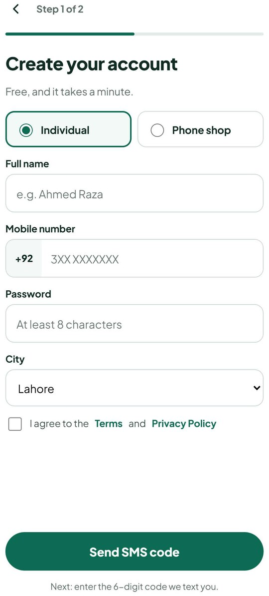</td>
    <td>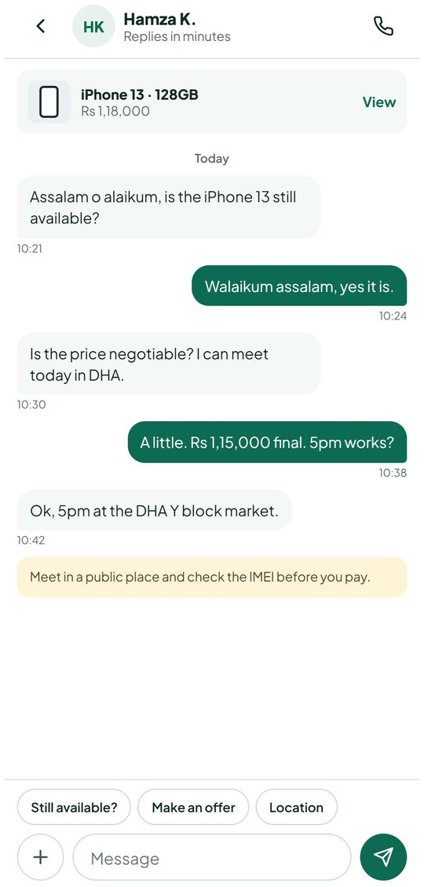</td>
    <td>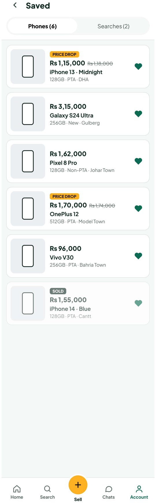</td>
  </tr>
  <tr>
    <th>My account</th><th>Seller profile</th><th>Settings</th><th></th>
  </tr>
  <tr valign="top">
    <td>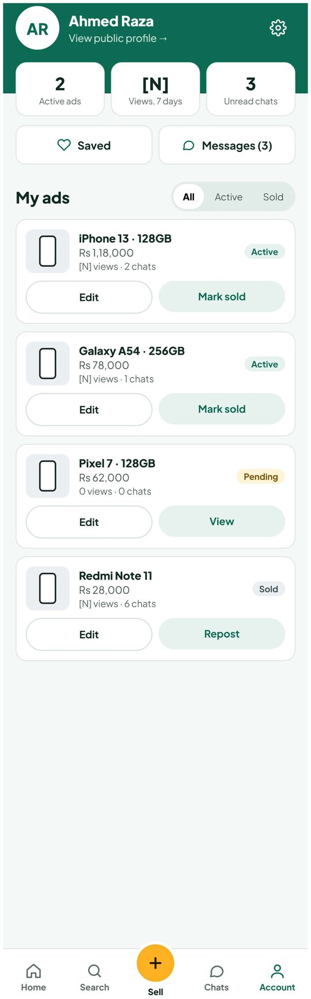</td>
    <td>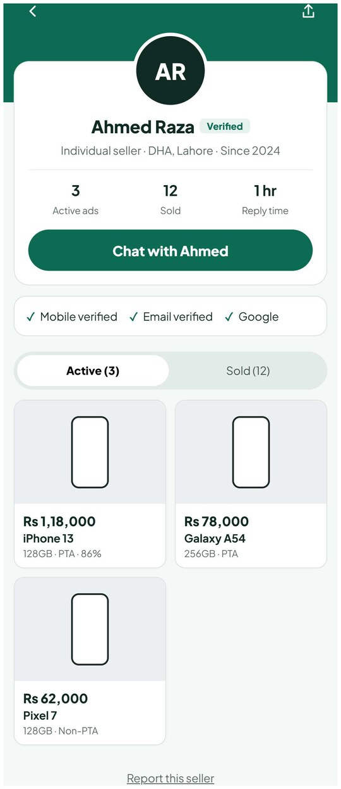</td>
    <td>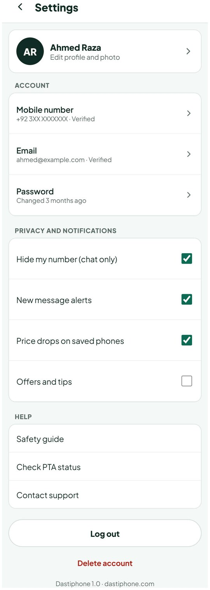</td>
    <td></td>
  </tr>
</table>

App stack: Expo Router, TanStack Query, Secure Store, push notifications, image picker, location and Socket.io client.

*Screens show design / demo data.*

## 👤 Author

**M. Umar Nasrullah**, product design and full-stack development (web, mobile, API, deployment)

[GitHub](https://github.com/umarnasrullah) · [LinkedIn](https://www.linkedin.com/in/muhammad-umar-nasrullah-657418264) · umarnasrullah870@gmail.com

---

© 2026 M. Umar Nasrullah. All rights reserved. See [LICENSE](LICENSE).
